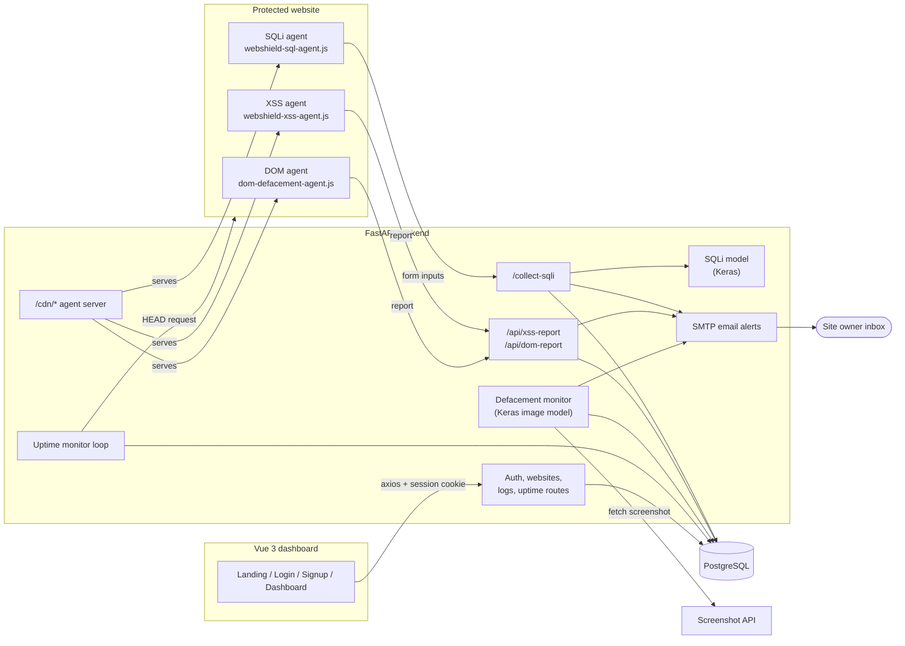
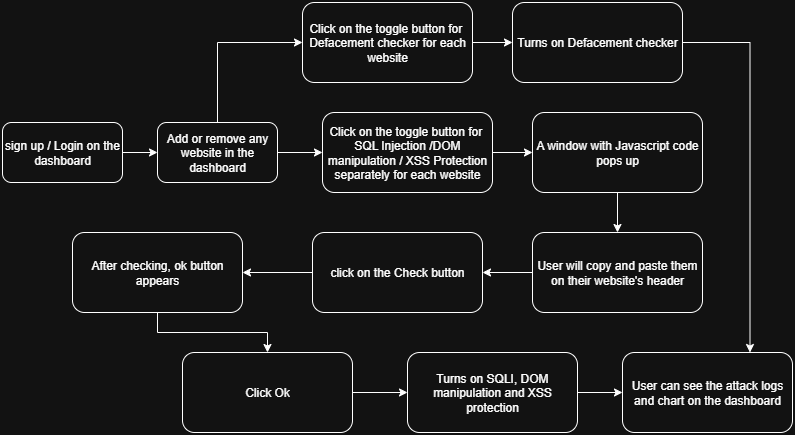
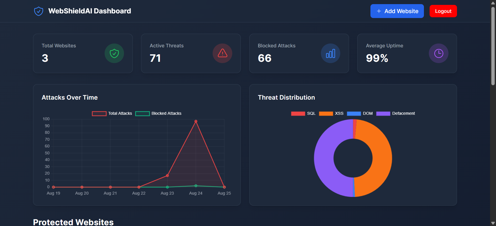
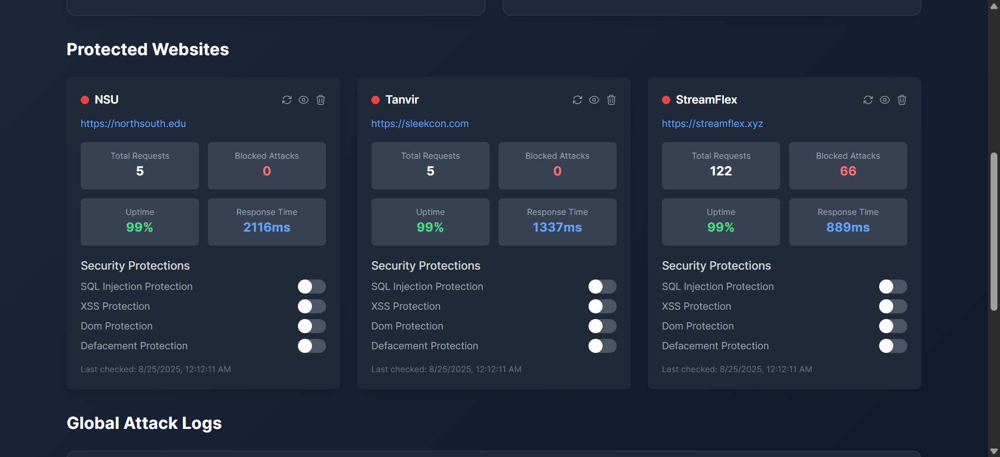
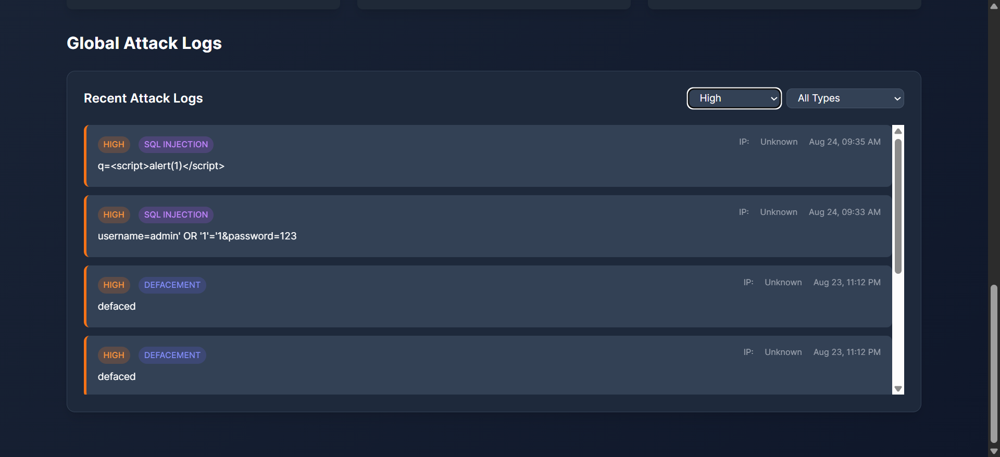
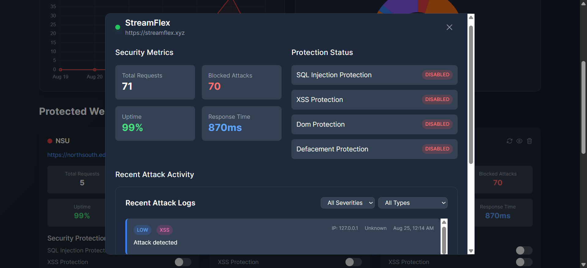

<div align="center">

# WebShield AI

**AI-powered web intrusion detection and auto-defense, delivered as a SaaS dashboard.**

Detects SQL injection, XSS, DOM tampering and visual defacement on your websites, logs every attempt, and emails the owner in real time.

<br/>


<br/>


</div>

---

## Overview

Small and medium-sized businesses are frequent targets of SQL injection, cross-site scripting, DOM manipulation and website defacement, yet most cannot afford enterprise security tooling. Traditional signature-based firewalls also struggle with new attack variants.

WebShield AI combines **machine learning models** with **lightweight JavaScript agents** that site owners drop into their pages with a single `<script>` tag. Agents report suspicious activity to a FastAPI backend, which classifies, logs and alerts, while a Vue dashboard gives owners one place to manage sites, toggle protections and review attacks.

## Key Features

| Module | How it works |
| --- | --- |
| **SQL Injection detection** | The SQL agent intercepts form submissions and sends input values to `/collect-sqli`. A Keras deep learning classifier (LSTM) scores each query; results are stored with a confidence score and malicious attempts trigger an alert. |
| **XSS detection** | The XSS agent checks URL parameters and form inputs against suspicious patterns (`<script>`, `javascript:`, inline event handlers, `document.cookie`, and more), blocks the submission, reports to `/api/xss-report` and redirects the visitor to the home page. |
| **DOM tampering detection** | The DOM agent uses a `MutationObserver` to watch for injected `SCRIPT`, `IFRAME`, `EMBED`, `OBJECT`, `LINK` and `STYLE` nodes, reports to `/api/dom-report` and redirects to the home page. |
| **Visual defacement detection** | When enabled, a background monitor captures a screenshot of the site every 60 seconds and classifies it as `clean` or `defaced` with a Keras image model (CNN). |
| **Uptime monitoring** | An async loop checks every registered site every 60 seconds, recording status code and response time. The dashboard shows per-site and global uptime over 1 to 90 days. |
| **Email alerts** | Every detected SQLi, XSS, DOM or defacement event emails the site owner with the site, attack type, timestamp and details (IP, query, prediction, score). |
| **Owner dashboard** | Add and remove websites, toggle each protection module, copy the agent snippet, verify it is installed on the live site, and view attack logs, charts and blocked-attack counts. |
| **Session auth** | Sign up, log in and log out with bcrypt-hashed passwords and cookie-based sessions. |

## Architecture



A visual flowchart is also included in the repo:



## Tech Stack

| Layer | Technologies |
| --- | --- |
| Frontend | Vue 3, TypeScript, Vite, Vue Router, Tailwind CSS, Chart.js (vue-chartjs), Axios, Heroicons, Iconify |
| Backend | FastAPI, Uvicorn, Starlette sessions, Pydantic |
| Database | PostgreSQL, SQLAlchemy |
| Machine Learning | TensorFlow / Keras (SQLi and defacement models), scikit-learn + joblib (DOM model artifacts) |
| Monitoring | httpx (async uptime checks), Requests, Pillow (screenshot decoding) |
| Agents | Vanilla JavaScript served by the backend (`MutationObserver`, form interception) |
| Alerts | SMTP over SSL (`smtplib`) |

## Project Structure

```
WebShieldAI/
├── Backend/
│   ├── main.py                 # FastAPI app, all routes, agent JS served from /cdn/*
│   ├── models.py               # SQLAlchemy models: User, Website, SQL/XSS/DOM/Defacement logs, UptimeCheck
│   ├── schemas.py              # Pydantic request/response schemas
│   ├── services.py             # User/website creation, bcrypt auth, SQL prediction service
│   ├── auth.py                 # Session-based current-user dependency
│   ├── db.py                   # Engine, session factory, table creation
│   ├── ml_model.py             # SQLi and DOM model loading and inference
│   ├── defacement_control.py   # Starts/stops per-site defacement monitor threads
│   ├── defacement_loop.py      # Screenshot capture + image classification loop
│   ├── uptime.py               # Async uptime monitor
│   ├── notifications.py        # SMTP email alerts and HTML templates
│   ├── config.py               # SMTP settings read from environment
│   ├── requirements.txt
│   └── ml/                     # Trained models (.h5, .pkl)
├── frontend/
│   ├── src/
│   │   ├── components/
│   │   │   ├── Dashboard/      # AttackLogs, MetricsCard, SecurityChart, WebsiteCard
│   │   │   ├── UI/             # Add-website and protection toggle modals
│   │   │   └── *.vue           # Landing, Login, Signup, Dashboard pages
│   │   ├── composables/        # useAuth, useDashboard, axios instance
│   │   ├── router/             # Routes with auth guard on /dashboard
│   │   └── types/
│   ├── package.json
│   └── vite.config.ts
├── flowchart2.png
└── ss1.png ... ss4.png         # Dashboard screenshots
```

## Getting Started

### Prerequisites

- Python 3.11+
- Node.js and npm
- PostgreSQL running locally

### 1. Backend

```bash
cd Backend
python -m venv venv
source venv/bin/activate        # Windows: venv\Scripts\activate
pip install -r requirements.txt
pip install httpx "passlib[bcrypt]" itsdangerous   # imported by the code but not yet pinned in requirements.txt
python -m uvicorn main:app --reload
```

The API starts on `http://127.0.0.1:8000` and creates its tables on startup. Run it from inside `Backend/` so the models in `ml/` resolve correctly. Interactive docs are available at `/docs`.

The database connection string is set in `Backend/db.py` (defaults to a local `postgres` database on port 5432).

### 2. Frontend

```bash
cd frontend
npm install
npm run dev
```

The dashboard expects the API at `http://localhost:8000` (configured in `src/composables/axios.ts`).

### 3. Protect a website

1. Sign up, log in and add your website from the dashboard.
2. Enable a protection module and copy its snippet, for example:
   ```html
   <script src="http://127.0.0.1:8000/cdn/webshield-xss-agent.js?wid=YOUR_WEBSITE_ID"></script>
   ```
3. Paste it into your site and use the dashboard's verify step, which checks the live page for the snippet.

## Environment Variables

All secrets are read from the environment by `Backend/config.py`, which also loads a `Backend/.env` file if present. Copy `Backend/.env.example` to `Backend/.env` and fill in your values.

| Variable | Purpose |
| --- | --- |
| `SMTP_HOST` | SMTP server host (default `smtp.gmail.com`) |
| `SMTP_PORT` | SMTP server port, SSL (default `465`) |
| `SMTP_USERNAME` | SMTP login user |
| `SMTP_PASSWORD` | SMTP login password or app password |
| `FROM_EMAIL` | Sender address for alerts |
| `FROM_NAME` | Sender display name |
| `SCREENSHOTONE_ACCESS_KEY` | ScreenshotOne API key used by the defacement monitor |
| `SESSION_SECRET_KEY` | Signs session cookies. If unset, a random key is generated at startup and sessions reset on restart |

## API Endpoints

| Method | Endpoint | Description |
| --- | --- | --- |
| `POST` | `/users/` | Register a user |
| `POST` | `/login` | Log in and start a session |
| `GET` | `/me` | Current user profile |
| `POST` | `/logout` | End the session |
| `POST` | `/websites/` | Add a website |
| `GET` | `/websites/` | List the current user's websites |
| `GET` | `/websites/me` | List the current user's websites |
| `GET` | `/websites/{website_id}` | Get one website |
| `DELETE` | `/websites/{website_id}` | Delete a website |
| `POST` | `/websites/{website_id}/toggle-defacement` | Start or stop the defacement monitor |
| `POST` | `/websites/{website_id}/update-protection` | Toggle `sqli`, `xss` or `dom` protection |
| `GET` | `/websites/{website_id}/attack-logs` | Attack logs for a website |
| `GET` | `/websites/{website_id}/blocked-count` | Blocked attack counts for a website |
| `GET` | `/websites/{website_id}/uptime` | Uptime metrics for a website (`days` 1 to 90) |
| `GET` | `/summary/uptime` | Uptime summary across the user's websites |
| `GET` | `/me/attack-logs/total-count` | Attack totals by type for the user |
| `POST` | `/predict-sqli/` | Classify a SQL query |
| `POST` | `/collect-sqli` | SQLi agent report endpoint |
| `POST` | `/api/xss-report` | XSS agent report endpoint |
| `POST` | `/api/dom-report` | DOM agent report endpoint |
| `GET` | `/check-cdn-code` | Verify an agent snippet is present on the live site |
| `GET` | `/cdn/webshield-sql-agent.js` | Serve the SQLi agent (`?wid=`) |
| `GET` | `/cdn/webshield-xss-agent.js` | Serve the XSS agent (`?wid=`, optional `debug=1`) |
| `GET` | `/cdn/dom-defacement-agent.js` | Serve the DOM agent (`?wid=`, optional `debug=1`) |

## Screenshots

| Dashboard | Protected Websites |
| :---: | :---: |
|  |  |
| **Global Attack Logs** | **Website Security Details** |
|  |  |

## Roadmap

- Federated learning for privacy-preserving model updates
- Zero-trust integrations
- Blockchain-based tamper-proof attack logs

## Author

**Md Tanvir Chowdhury**

[](https://github.com/Tanvir-Chowdhury)
[](https://tanvir-chowdhury.github.io/tanvir-portfolio/)
